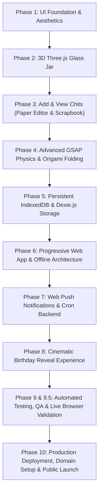

# Memory Jar — Little moments. A lifetime of memories. ♡

> A cozy, emotional, interactive 3D digital memory-keeping sanctuary. Store your happiest moments in a virtual glass jar throughout the year and open it on your birthday.

---

## 1. Who You Are, What You Do & Skills Learned

### Who You Are
A **Creative Frontend & Full-Stack Interaction Engineer** specializing in animation-rich, 3D-integrated web experiences, local-first software architecture, and user-centric emotional design.

### What You Do
You architect and craft immersive web applications that bridge technical engineering and emotional storytelling. You specialize in bringing tactile real-world metaphors (such as glass jars, folding origami paper chits, and physical scrapbooks) into high-performance, responsive browser experiences that work offline and respect user privacy.

### Skills Learned & Demonstrated
* **3D Creative Web Development:** Modeling glass transmission, lighting, reflections, procedural materials, and particle effects using Three.js and React Three Fiber.
* **Physics & Timeline Choreography:** Complex multi-stage animation synchronization using GSAP (ballistic arcs, 3D paper folding, lid popping, confetti eruptions).
* **Local-First Browser Persistence:** Designing client-side offline database schemas with Dexie.js and IndexedDB, managing image Blobs, memory caching, and object URL lifecycles.
* **Progressive Web App (PWA) Engineering:** Crafting custom Service Workers with multi-tier caching (Network-First, Cache-First), background idle preloading, install prompts, and full offline usability.
* **Web Push & Background Scheduling:** Integrating the W3C Web Push API, VAPID cryptographic handshakes, and timezone-aware cron schedulers using Node.js and Express.
* **Full-Stack DevOps & Production Deployment:** Code splitting, chunk optimization, SPA fallback routing on Vercel, persistent volume configuration on Render, and Docker containerization.

---

## 2. Technologies

### Frontend & Creative Engine
* **Core Framework:** React 19 (Functional components, hooks, suspense, lazy loading)
* **Build Tool & Bundler:** Vite 8 (ESM-native, sub-2-second HMR and production builds)
* **3D Graphics:** Three.js & @react-three/fiber (Declarative WebGL canvas, glass transmission, camera rig)
* **3D Helpers:** @react-three/drei (Environment lighting, smooth orbit controls, mesh abstractions)
* **Animation Engine:** GSAP 3 (GreenSock Animation Platform: timeline sequencing, custom bezier curves, 3D CSS transforms)
* **Particle & FX:** Canvas Confetti (Cinematic birthday celebration eruptions)
* **Icons & Typography:** Lucide React, Google Fonts (*Outfit*, *Caveat*, *Playfair Display*)

### Storage & Offline Architecture
* **Browser Database:** IndexedDB via Dexie.js v4 (Reactive queries, transactional safety, binary Blob photo storage)
* **Offline Infrastructure:** Custom Service Worker (`sw.js`) & Web App Manifest (`manifest.webmanifest`)

### Backend & Push Notification Service
* **Runtime:** Node.js 22 LTS
* **Web Framework:** Express 4.21
* **Push Notifications:** `web-push` (VAPID authentication, payload encryption)
* **Background Scheduling:** `node-cron` (5-minute interval timezone-aware evaluation)
* **Atomic Storage:** Node `fs` with temporary write-and-rename atomic commits and automated `.backup.json` recovery

### Testing & DevOps
* **Automated Testing:** Node.js Native Test Runner (`node --test`), 25 unit/integration tests
* **Browser E2E Testing:** Playwright (Live Chrome window automation across 5 device viewports)
* **Frontend Hosting:** Vercel (Edge CDN, SPA wildcard rewrites, zero-cache SW headers)
* **Backend Hosting:** Render Web Service (Persistent Disk mount at `/var/data`) & Docker

---

## 3. Features

* **Interactive 3D Glass Jar:** Real-time physical glass jar with specular reflections, soft ground contact shadow, physical cork/wooden lid, decorative hanging heart tags, fairy firefly lights, and visible 3D paper chits resting inside. Clicking the jar or buttons triggers tactile bouncing reactions.
* **Paper-Folding Memory Editor:** Warm paper editor with textarea, custom date selector, memory photo attachment, and pastel chit color palette. Submitting choreographs a progressive 3D fold that physically launches in a ballistic parabolic arc, opens the jar lid, and drops directly into the glass jar.
* **Cozy Scrapbook Gallery:** Chronological, scrapbook-styled photo album displaying all saved memories with paper textures, washi tape, inline editing, photo inspection, and two-step safety deletion.
* **Persistent Local-First Storage:** Permanent client-side persistence in IndexedDB. Memories and attached photos survive reloads and cache flushes with an in-memory Blob URL cache that prevents memory leaks.
* **Offline JSON Backup & Restore:** One-click export of memories and base64-encoded photos into an offline `.json` backup file, with schema-validated restore capabilities.
* **Installable Progressive Web App (PWA):** Installable directly to home screens on iOS/Android or desktop docks on macOS/Windows. Fully functional offline with zero network connectivity.
* **Birthday Push Reminders:** Users configure their birthday and preferred reminder time. The backend securely checks every 5 minutes against the user's local timezone and delivers an encrypted notification even when the browser tab is closed.
* **Signature Birthday Reveal Experience:** Clicking the notification (or triggering `/?reveal=true`) opens a cinematic sequence: lid pops off, all saved memories erupt upward with celebratory confetti, and a fullscreen interactive slideshow guides the user through every moment of their year.
* **Privacy, Terms & User Trust:** Clear legal transparency explaining local-first storage, absence of tracking cookies, device boundaries, and memory ownership.

---

## 4. Keyboard Shortcuts

| Shortcut | Context / Location | Action Performed |
| :--- | :--- | :--- |
| <kbd>Escape</kbd> | Any Open Modal | Instantly closes the active modal (Add Chit, Scrapbook, Backup, Reveal, Privacy). |
| <kbd>Ctrl</kbd> + <kbd>Enter</kbd> / <kbd>Cmd</kbd> + <kbd>Enter</kbd> | Add Chit Paper Editor | Quick Save: Immediately triggers paper fold and submits the memory chit. |
| <kbd>Arrow Right</kbd> / <kbd>→</kbd> | Birthday Reveal Slideshow | Advance to the next memory card. |
| <kbd>Arrow Left</kbd> / <kbd>←</kbd> | Birthday Reveal Slideshow | Step back to the previous memory card. |
| <kbd>Space</kbd> | Slideshow & Modals | Pause / resume automated playback or trigger actions. |
| <kbd>Tab</kbd> / <kbd>Shift</kbd> + <kbd>Tab</kbd> | Entire Application | Accessible keyboard focus navigation across all buttons, inputs, and interactive cards. |

---

## 5. The Process

The project followed a disciplined 10-phase engineering trajectory:



1. **Phase 1 (Homepage & UI):** Established the visual identity, warm paper textures, badge headers, and responsive CSS grid.
2. **Phase 2 (3D Interactive Jar):** Built the Three.js glass jar using custom transmission materials, realistic thickness, cork lid, and fairy lighting.
3. **Phase 3 (Add & View Chits):** Developed the memory editor and scrapbook gallery modal.
4. **Phase 4 (Advanced Paper Physics):** Choreographed multi-stage origami paper folds, bezier flight trajectories, and lid reaction timings using GSAP timelines.
5. **Phase 5 (Persistent IndexedDB):** Migrated transient React state into Dexie.js, adding schema migrations, photo Blob storage, and JSON backup/restore.
6. **Phase 6 (PWA & Offline):** Crafted service worker caching strategies, web app manifest, offline status indicators, and background idle preloading.
7. **Phase 7 (Birthday Push Notifications):** Built the Express backend, VAPID encryption handshake, timezone calculations, and automated `node-cron` scheduler.
8. **Phase 8 (Birthday Reveal):** Crafted the signature cinematic finale: lid opening, memory eruption, confetti explosion, and interactive slideshow.
9. **Phase 9 & 9.5 (QA & Browser Validation):** Wrote 25 automated tests, resolved photo memory leaks and canvas render impurities, and validated 14 end-to-end workflows in a real Chrome browser across 5 viewports.
10. **Phase 10 (Deployment & DevOps):** Configured Vercel SPA rewrites, Render persistent disk blueprints, Docker containerization, DNS architecture, and legal trust modals.

---

## 6. What I Learned

* **Three.js Performance & React Reconciliation:** How to prevent WebGL canvas re-renders by hoisting deterministic PRNG texture generators to module scope, isolating heavy 3D bundles, and using Drei abstractions cleanly.
* **Timeline Synchronization & Event Preservation:** The nuances of GSAP timeline chaining—specifically ensuring that overwriting callbacks (like `onComplete`) preserves preexisting completion handlers rather than blocking UI transitions.
* **Browser Memory Management with Blobs:** Managing binary data in IndexedDB requires disciplined URL revocation. Creating an in-memory `photoUrlCache` that revokes previous `blob:` URLs prevents severe memory leaks when users attach photos.
* **Offline-First PWA Realities:** Why lazy-loaded React chunks can fail offline if not fetched in advance, and how using `window.requestIdleCallback` to preload chunks during idle periods solves offline navigation completely.
* **Timezone Math & Scheduler Precision:** The complexity of matching user birthdays across worldwide timezones without polling or server overload, using IANA timezone identifiers and leap-year fallbacks.
* **Local-First Privacy Architecture:** How to build rich modern web apps where user data stays 100% on their own machine, eliminating database hosting costs and safeguarding personal privacy.

---

## 7. Overall Growth

* **From UI Coder to Creative Systems Architect:** Evolved beyond standard flat web interfaces into 3D spatial computing, tactile physics, and cinematic micro-interactions.
* **DevOps & Infrastructure Mastery:** Gained hands-on mastery over decoupled full-stack deployments, understanding why standing cron workers require persistent container runtimes (Render/Railway) while static assets thrive on serverless edges (Vercel).
* **Deep QA Discipline:** Shifted from "it works on my machine" to automated unit testing, memory leak profiling, and multi-device browser automation using Playwright.
* **Empathy & UX Integrity:** Learned that software is most powerful when it evokes emotion. The animations, sounds, and warm aesthetic transform a technical database into a cherished personal keepsake.

---

## 8. How It Can Be Implemented (Setup & Deployment Guide)

### Prerequisites
* [Node.js](https://nodejs.org/) v20.x or v22.x LTS
* [Git](https://git-scm.com/)

### Step 1: Clone and Inspect the Project
```bash
git clone https://github.com/Shravannaik285/MemoryJar.git
cd MemoryJar
```

### Step 2: Install Dependencies
```bash
# Install client dependencies
cd client
npm install

# Install server dependencies
cd ../server
npm install
cd ..
```

### Step 3: Run in Local Development Mode
You can launch both frontend and backend concurrently:

```bash
# Terminal 1: Start Backend Notification Service (Port 5000)
cd server
npm run dev

# Terminal 2: Start Frontend Application (Port 5173)
cd client
npm run dev
```
Open [http://localhost:5173](http://localhost:5173) in your browser. Vite proxies `/api` requests to the backend on port 5000.

### Step 4: Run Automated Tests
```bash
# Run all 25 unit and integration tests from root
npm test
```

### Step 5: Production Deployment

#### Frontend on Vercel:
1. Connect your repository at [vercel.com](https://vercel.com).
2. Set **Root Directory** to `client`.
3. Set **Build Command** to `npm run build` and **Output Directory** to `dist`.
4. Configure Environment Variables:
   * `VITE_API_BASE_URL`: `https://your-backend.onrender.com`
   * `VITE_VAPID_PUBLIC_KEY`: `BIKZISjQ8G8ovWn0tdrMYkAXlWWs-C4wDGFd8GZNknepGflYRDTw7LP0QblSQB_1gSJd8ceydDWBhH-RYIZ114k`
5. Deploy. Vercel automatically applies SPA rewrites and caching headers from `client/vercel.json`.

#### Backend on Render:
1. Create a **New Web Service** at [render.com](https://render.com).
2. Set **Root Directory** to `server`.
3. Set **Start Command** to `node server.js`.
4. Attach a **1GB Persistent Disk** mounted at `/var/data`.
5. Configure Environment Variables:
   * `NODE_ENV`: `production`
   * `PORT`: `5000`
   * `DATA_DIR`: `/var/data`
   * `FRONTEND_URL`: `https://your-frontend.vercel.app`
   * `VAPID_PUBLIC_KEY`: `BIKZISjQ8G8ovWn0tdrMYkAXlWWs-C4wDGFd8GZNknepGflYRDTw7LP0QblSQB_1gSJd8ceydDWBhH-RYIZ114k`
   * `VAPID_PRIVATE_KEY`: `[YOUR_SECRET_PRIVATE_KEY]`
   * `VAPID_SUBJECT`: `mailto:hello@memoryjar.app`
6. Deploy. The backend will run 24/7, persisting subscriptions and evaluating birthday notifications every 5 minutes.
